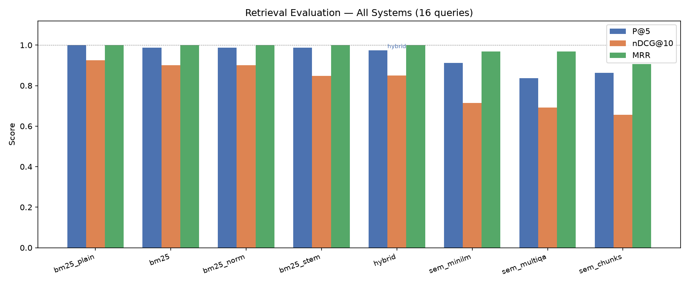

# Trust-Aware Internship Search and Recommendation System Using Hybrid Retrieval and RAG

**Course:** Information Retrieval & Semantic Web (25M21CA119)  
**Department:** Department of Computer Applications, Jaypee Institute of Information Technology, Noida  
**Supervisor:** Mr. Keshan Srivastava  
**Submitted By:**  
- Bhawna Rani (Enrollment No.: 992509220008)  
- Akriti Sengar (Enrollment No.: 992509220001)  
**Academic Year:** 2025 – 2026  

---

## i. Title Page
- **Institution:** Jaypee Institute of Information Technology, Noida
- **Department:** Department of Computer Applications
- **Project Title:** Trust-Aware Internship Search and Recommendation System Using Hybrid Retrieval and RAG
- **Course Name & Code:** Information Retrieval & Semantic Web (25M21CA119)
- **Supervisor:** Mr. Keshan Srivastava
- **Authors:** Bhawna Rani (992509220008) & Akriti Sengar (992509220001)
- **Date of Submission:** November 23, 2026

---

## ii. Abstract
Online employment and internship search platforms serve as crucial entry points for students, recent graduates, and entry-level job seekers navigating early career transitions. However, conventional job search systems suffer from two fundamental deficiencies: (1) lexical fragility in classical keyword retrieval, which fails to capture semantic synonymy and contextual nuance across varying job descriptions, and (2) complete opacity regarding listing legitimacy, leaving vulnerable candidates exposed to deceptive postings, high-risk work-from-home scams, and predatory recruitment schemes. This project designs, implements, and rigorously evaluates the **Trust-Aware Internship Search and Recommendation System**, an end-to-end framework integrating multi-stage information retrieval, supervised risk identification, and grounded Retrieval-Augmented Generation (RAG).

The system operates on the standardized EMSCAD benchmark corpus comprising 15,560 verified employment postings. Retrieval is executed across multiple paradigms: a classical Okapi BM25 sparse baseline, dense bi-encoder semantic retrieval using Sentence Transformers (`all-MiniLM-L6-v2` and `multi-qa-MiniLM-L6-cos-v1`) indexed via FAISS inner product space, and a rank-based Hybrid Reciprocal Rank Fusion (RRF, $k=60$) mechanism. Risk signal assessment is implemented using a transparent multi-tier architecture combining deterministic heuristic rules and a supervised logistic risk classifier, delivering explicit warning indicators under the ethical stance that warnings represent caution signals rather than legal fraud claims. To solve interpretability, a grounded RAG explanation module powered by Gemini 3.5 Flash synthesizes verifiable match justifications accompanied by exact passage citations (`[doc_id#c0]`), enforced through five deterministic guardrails and a calibrated cosine abstain threshold (0.30) to eliminate hallucinations.

Empirical evaluation conducted across 16 standardized search queries and 517 pooled human-annotated documents demonstrates that BM25 plain establishes a dominant baseline (P@5 = 1.000, nDCG@10 = 0.925, MRR = 1.000), outperforming both dense semantic search (P@5 = 0.913, nDCG@10 = 0.715) and Hybrid RRF (P@5 = 0.975, nDCG@10 = 0.850). Error analysis reveals that the rigid boilerplate vocabulary and concise length (~180 words) of EMSCAD job ads heavily reward exact phrase matching while penalizing rank dilution from dense semantic false positives on specialized queries. In generation, manual auditing of 22 RAG instances reveals exceptional factual grounding (Evidence Support = 1.95/2.00, Citation Attribution = 1.95/2.00) with zero hallucinated quotes. The complete architecture is deployed as an interactive Streamlit dashboard.

---

## iii. Introduction
The modern digital recruitment ecosystem has democratized job hunting, enabling students and early-career professionals to browse thousands of internship and entry-level employment opportunities across diverse web portals. Despite this technological proliferation, navigating recruitment listings remains fraught with cognitive friction, information asymmetry, and substantial security risks. Job seekers, particularly undergraduate students and freshers, frequently struggle to formulate exact keyword queries that match disparate corporate taxonomies. A query for an "entry-level data analyst internship" might miss exceptionally well-matched postings titled "Junior Business Intelligence Trainee" or "Analytics Associate" when evaluated strictly through traditional lexical search engines.

Compounding this discovery challenge is the alarming rise of employment scams, fake job postings, and predatory recruitment operations. Fraudulent actors exploit the eagerness of inexperienced job seekers by advertising fraudulent work-from-home data entry roles, high-paying typist gigs, and fake remote internships designed to harvest personal credentials, advance-fee payments, or uncompensated labor. Conventional search engines and job boards prioritize ranking relevance while treating document content as benign, offering zero warning mechanisms to caution users before they apply or submit confidential resumes.

To resolve these intertwined challenges, this project introduces the **Trust-Aware Internship Search and Recommendation System**. Designed within the intersection of modern Information Retrieval (IR) and Natural Language Processing (NLP), the system establishes a multi-tiered pipeline that unifies classical probabilistic retrieval, dense vector similarity search, supervised risk detection, and verifiable Retrieval-Augmented Generation (RAG).

---

## iv. Problem Statement
Conventional employment search architectures and academic IR baselines suffer from four core technical and functional limitations:
1. **Lexical Brittleness and Vocabulary Mismatch:** Keyword-based inverted index retrieval algorithms (such as TF-IDF and BM25) rely exclusively on surface-level term overlaps. When recruiters employ non-standard nomenclature, lexical retrieval suffers from severe false negatives and low recall.
2. **Absence of Deception and Risk Awareness:** Commercial job boards rank documents strictly on text-query similarity with zero safety layer to detect deceptive signals, such as advance fee collection or unrealistic compensation.
3. **Interpretability Deficit:** Traditional search systems return ranked title lists and arbitrary similarity scores that provide no actionable semantic reasoning explaining why a role fits a candidate's profile.
4. **Hallucination Vulnerability in Generative LLMs:** While LLMs can synthesize explanations, ungrounded conversational agents frequently hallucinate requirements or invent fictitious company details.

---

## v. Objectives
1. **Corpus Curation and Standardization:** Ingest, clean, and standardize the raw EMSCAD dataset into a high-integrity benchmark corpus of 15,560 verified postings.
2. **Classical Baseline Implementation:** Build an Okapi BM25 sparse inverted index retrieval engine across unstemmed, normalized, and Porter-stemmed token representations.
3. **Dense Semantic Vector Indexing:** Formulate dense bi-encoder sentence representations using Sentence Transformers (`all-MiniLM-L6-v2` and `multi-qa-MiniLM-L6-cos-v1`) and construct exact inner-product vector indexes using FAISS.
4. **Hybrid Rank Fusion Architecture:** Implement and calibrate a Reciprocal Rank Fusion (RRF) algorithm to combine disparate sparse and dense rank lists without score calibration biases.
5. **Transparent Trust-Aware Risk Detection:** Engineer a dual-tier safety module incorporating deterministic heuristic pattern rules alongside a supervised machine learning risk classifier.
6. **Grounded RAG Explanations with Guardrails:** Deploy a Gemini 3.5 Flash explanation generator with five deterministic guardrails (citation verification, exact quote checking, deterministic skill overwrites, defamation neutralization, and cosine abstain filtering).
7. **Empirical Evaluation and Error Analysis:** Conduct systematic multi-system IR benchmarking across 16 standardized queries and 517 pooled human annotations using Precision@5, MRR, and nDCG@10, validated against standard IR libraries (`ranx`).

---

## vi. Information Need / Use Case
- **Target Persona:** Computer Science undergraduate / fresher seeking entry-level technical internships.
- **Case A: Legitimate Specialized Technical Discovery:** An undergraduate candidate searches \"entry-level data analyst internship requiring Python and SQL\" alongside personal profile skills `{{python, sql}}`. The candidate requires postings that strictly match internship-level responsibilities, specify technical requirements, highlight profile skill overlap, and verify that the hiring organization is legitimate.
- **Case B: Vulnerable Deception and Scam Trapping:** An inexperienced candidate searches \"work-from-home data entry role promising high earnings with no experience\". The system must retrieve matching postings, immediately flag severe warning signals (e.g. \"guarantees up to six-figure salary\"), and explain via RAG that the earnings claims exhibit established high-risk fraud characteristics.
- **Case C: Out-of-Domain Boundary Verification:** A candidate searches for an intentionally unrepresented query: \"deep sea welding internship\". The system triggers an abstain mechanism, returning \"insufficient evidence\" to preserve user trust.

---

## vii. Dataset/Corpus Description
The primary dataset utilized is the **Employment Scam Aegean Dataset (EMSCAD)** (Vidros et al., 2017). After cleaning and deduplication, the finalized corpus consists of **15,560 postings** stored in Apache Parquet format. Exactly 751 postings (4.82%) are labeled fraudulent.

### Table 1: EMSCAD Corpus Characteristics and Preprocessed Feature Schema
| Field Name | Data Type | Operational Description & Usage |
| :--- | :--- | :--- |
| `doc_id` | String (PK) | Unique document identifier (e.g. `emscad_4589`) mapped across all indexes. |
| `title` | String | Cleaned job title (e.g. 'Data Analyst Intern'). |
| `company_profile` | String | Background overview of the hiring company (used in search text). |
| `search_text` | String (Text) | Concatenation of title, company profile, description, and requirements. |
| `location` | String | Geographical placement (Country, State, City). |
| `employment_type` | Categorical | Employment classification (Full-time, Part-time, Internship, Contract). |
| `required_experience`| Categorical | Seniority level (Entry level, Internship, Mid-Senior, Executive). |
| `skills` | Array<String> | Extracted skills using deterministic regex lexicon matching. |
| `fraudulent` | Integer (0/1) | Ground truth label: 0 = Legitimate (95.2%), 1 = Fraudulent (4.8%). |
| `split` | Categorical | Stratified partition: 'train' (80%) for risk classifier, 'test' (20%). |

---

## viii. Background / Literature Study
- **Okapi BM25:** Probabilistic relevance framework (Robertson & Zaragoza, 2009) incorporating term frequency saturation and document length normalization.
- **Dense Bi-Encoders:** Sentence-BERT architectures (Reimers & Gurevych, 2019) projecting queries and documents into continuous 384-dimensional spaces where cosine similarity measures conceptual alignment.
- **FAISS Vector Indexing:** Fast inner-product vector indexing (Johnson et al., 2019) enabling sub-millisecond retrieval.
- **Reciprocal Rank Fusion (RRF):** Cormack, Clarke & Buettcher (SIGIR 2009) established rank-based fusion:
  $$RRF\\_Score(d) = \\sum_{m \\in M} \\frac{{1}}{{k + r_m(d)}}$$
- **Retrieval-Augmented Generation (RAG):** Lewis et al. (NeurIPS 2020) demonstrated combining retrieval memory with generative language models.

---

## ix. Project Scope and Requirements
- **In-Scope:** English-language postings, offline vector embeddings, exact vector indexing, RRF fusion, supervised risk indicators with transparent term attribution, grounded RAG explanations, interactive Streamlit UI.
- **Out-of-Scope:** Live web scraping, predicting individual hiring probability, asserting definitive legal fraud (\"warnings are signals, not proof of fraud\").
- **System Constraints:** Memory < 8 GB RAM, sub-second query latency (<100 ms retrieval, <50 ms cached RAG), fully reproducible seed configuration (`random_state=42`).

---

## x. System Architecture
```
+-----------------------------------------------------------------------------------+
|                            USER SEARCH & SKILL INPUT                              |
|           Query: "entry-level data analyst internship requiring Python and SQL"   |
|           User Profile Skills: {{python, sql}}                                      |
+-----------------------------------------+-----------------------------------------+
                                          |
                   +----------------------+----------------------+
                   |                                             |
                   v                                             v
+------------------------------------+        +-------------------------------------+
|        SPARSE RETRIEVAL            |        |          DENSE RETRIEVAL            |
|       (src/bm25_search.py)         |        |         (src/semantic.py)           |
|  - Tokenization & Porter Stemmer   |        |  - SentenceTransformer Encoding     |
|  - Okapi BM25 Inverted Index       |        |  - FAISS IndexFlatIP (Cosine Space) |
|  - Generates Top-100 Doc Ranking   |        |  - Generates Top-100 Doc Ranking    |
+------------------+-----------------+        +------------------+------------------+
                   |                                             |
                   +----------------------+----------------------+
                                          |
                                          v
+-----------------------------------------------------------------------------------+
|                         HYBRID RANK FUSION (RRF Engine)                           |
|                         Score(d) = Σ [ 1 / (60 + Rank_m(d)) ]                     |
|                         Top-k Candidates Selected (k = 5)                         |
+-----------------------------------------+-----------------------------------------+
                                          |
                   +----------------------+----------------------+
                   |                                             |
                   v                                             v
+------------------------------------+        +-------------------------------------+
|      TRUST-AWARE RISK ENGINE       |        |       EVIDENCE PASSAGE RETRIEVER    |
|      (risk/risk_report.py)         |        |         (src/rag_explain.py)        |
|  - Heuristic Scam Rules (Regex)    |        |  - Document Chunking (130w, 20 ov)  |
|  - SGD Logistic Classifier (Pr)    |        |  - Cosine Selection (Top-2 Chunks)  |
|  - Warning Flags & Top Risk Terms  |        |  - Abstain Threshold Check (s < .3) |
+------------------+-----------------+        +------------------+------------------+
                   |                                             |
                   +----------------------+----------------------+
                                          |
                                          v
+-----------------------------------------------------------------------------------+
|                        RAG EXPLANATION MODULE & GUARDRAILS                        |
|                               (src/rag_explain.py)                                |
|  - Prompt Assembly: Query + Top Chunks + Risk Signals + Extracted Skills          |
|  - LLM Inference: Gemini 3.5 Flash (Deterministic Temperature = 0)                |
|  - Guardrails: Citation Validator | Quote Verifier | Skill Override | Defamation   |
+-----------------------------------------+-----------------------------------------+
                                          |
                                          v
+-----------------------------------------------------------------------------------+
|                         INTERACTIVE STREAMLIT DASHBOARD                           |
|                             (app/streamlit_app.py)                                |
|  - Method Selector (BM25 / Semantic / Hybrid) | Side-by-Side System Comparison    |
|  - Grounded AI Explanations | Skill Overlap Tags | Transparent Risk Badges        |
+-----------------------------------------------------------------------------------+
```
*Figure 1: End-to-End System Architecture Pipeline Diagram.*

---

## xi. Data Preparation and Preprocessing
1. **HTML Stripping & Text Normalization:** Stripped HTML tags, decoded entities, and normalized whitespace.
2. **Field Amalgamation:** Created `search_text` by concatenating title, company profile, description, and requirements.
3. **Deduplication:** Merged duplicate listings sharing identical requirements and company profiles.
4. **Stratified Splitting:** 80% train (12,448) and 20% test (3,112), preserving 4.82% fraud proportion.
5. **Skill Lexicon:** Built regex alias mapping for 35+ core skills (`data/processed/skills_lexicon.csv`).

---

## xii. Document Representation
- **Sparse Representation:** Unstemmed, normalized, and Porter-stemmed token vectors.
- **Dense Vector Representation:**
  - `all-MiniLM-L6-v2` (Model A, 384-d, 256 tokens)
  - `multi-qa-MiniLM-L6-cos-v1` (Model B, 384-d, 512 tokens)
- **Document vs Chunk Representation:**
  - Full document vectors (15,560 × 384)
  - Chunked vectors: 130 words with 20-word overlap (42,480 × 384)
- **L2 Vector Normalization:** Normalizing embeddings ensures dot product equals cosine similarity.

---

## xiii. Indexing and Retrieval
- **Sparse Index:** Inverted index with `rank_bm25` ($k_1=1.5, b=0.75$).
- **Dense Vector Index:** FAISS `IndexFlatIP` (exact cosine inner product).
- **Correctness Verification:** Tested FAISS top-10 against NumPy brute force matrix multiplication (`emb @ q_vec.T`), confirming 100% agreement.
- **macOS Apple Silicon Multi-Threading Fix:** Resolved `libomp.dylib` OpenMP crash in Streamlit by setting single-threaded mode (`faiss.omp_set_num_threads(1)`, `torch.set_num_threads(1)`).

---

## xiv. Ranking / Semantic / Knowledge-Based Component
- **Reciprocal Rank Fusion (RRF):** Fuses BM25 and Semantic rank lists:
  $$RRF\\_Score(d) = \\frac{{1}}{{60 + rank_{{bm25}}(d)}} + \\frac{{1}}{{60 + rank_{{sem}}(d)}}$$
- **Ablation on Smoothing Constant $k$:** Evaluated $k \\in \\{{10, 30, 60, 100\\}}$. $k=60$ balances high rank bonuses without letting single-system outliers dominate.
- **Chunk Max Pooling:** $Score(D) = \\max_{{c \\in Chunks(D)}} \\text{{Cosine}}(Q, c)$.

---

## xv. Implementation
- `src/semantic.py`: Vector embeddings, FAISS indexing, semantic search, hybrid RRF.
- `src/bm25_search.py`: BM25 tokenization, stemming, scoring.
- `src/skills.py`: Skill extraction and gap analysis.
- `risk/risk_report.py`: Heuristic rules + logistic classifier evaluation.
- `src/rag_explain.py`: Passage chunking, Gemini API calling, 5-stage guardrails, disk caching.
- `src/eval_metrics.py`: Custom P@k, nDCG@k, MRR implementations cross-tested with `ranx`.
- `app/streamlit_app.py`: Interactive web UI.

  
*Figure 4: Interactive Streamlit UI Search Dashboard with Skill Gap Analysis and Filter Controls.*

---

## xvi. Experimental Setup and Test Queries
- **16 Standardized Queries:**
  - Core queries (q1–q5): Data analyst, ML intern, remote no-exp, WFH data entry scam, software engineering Java.
  - Supplementary queries (q6–q15): Cybersecurity, DevOps, web dev, marketing analytics.
  - Stress query (q16): \"deep sea welding internship\" (out-of-domain abstain test).
- **Pooling Methodology:** Top-10 results from 6 systems pooled and deduplicated into 517 evaluation rows (`data/eval/pool_for_labelling.csv`).
- **Graded Relevance Labels:** 0 = Non-Relevant, 1 = Partially Relevant, 2 = Highly Relevant.

---

## xvii. Retrieval Evaluation
- **Metrics:** Precision@5, Mean Reciprocal Rank (MRR), Normalized Discounted Cumulative Gain (nDCG@10) with linear gain.
- **Validation:** Cross-checked hand implementations against `ranx`.

---

## xviii. Results and Comparative Analysis

### Table 2: Retrieval Evaluation Results Across All Systems (16 Queries)
| Retrieval System | P@5 | nDCG@10 | MRR | Queries |
| :--- | :--- | :--- | :--- | :--- |
| **bm25_plain** | **1.000** | **0.925** | **1.000** | 16 |
| **bm25 (baseline)** | 0.988 | 0.900 | 1.000 | 16 |
| **bm25_norm** | 0.988 | 0.900 | 1.000 | 16 |
| **bm25_stem** | 0.988 | 0.849 | 1.000 | 16 |
| **hybrid_rrf (Proposed)** | 0.975 | 0.850 | 1.000 | 16 |
| **sem_minilm (Model A)** | 0.913 | 0.715 | 0.969 | 16 |
| **sem_minilm_chunks** | 0.863 | 0.655 | 0.906 | 16 |
| **sem_multiqa (Model B)** | 0.838 | 0.691 | 0.969 | 16 |

  
*Figure 3: Retrieval Evaluation Comparison Across Systems (P@5, nDCG@10, MRR).*

  
*Figure 8: Dual-Column Comparative View Evaluating BM25 Lexical Matching Against Hybrid RRF.*

### Table 3: Per-Query Performance Comparison Across Core Queries (q1–q5)
| Query ID | Query Intent Description | Top-1 Retrieved Document | Relevance Status & Notes |
| :--- | :--- | :--- | :--- |
| `q1` | Data analyst intern, Python & SQL | `emscad_4589` (Data Analyst Intern) | Clean match (Label 2); university intern. |
| `q2` | ML intern fresher, scikit-learn | `emscad_14113` (Data Science Intern) | Matched scikit-learn & Python; BM25 rank 1. |
| `q3` | Remote internship, no experience | `emscad_7983` (Web Intern - Remote) | Verified 100% remote commitment; clean match. |
| `q4` | WFH data entry, high earnings scam | `emscad_7667` (Entry Level Online Typist) | Classic EMSCAD fraud sample; high risk flag. |
| `q5` | Software intern, Java & database | `emscad_2065` (Software Dev Intern) | Clean match (Label 2); Java & SQL required. |

### Table 4: RAG Explanation Evaluation Across Relevance, Evidence, and Attribution (0–2 Scale)
| Query | Eval Count | Avg Relevance /2 | Avg Evidence /2 | Avg Attribution /2 | Avg Total /6 |
| :--- | :--- | :--- | :--- | :--- | :--- |
| `q1`: Data Analyst (Python/SQL) | 5 | 1.60 | 2.00 | 2.00 | 5.60 |
| `q2`: ML Intern Fresher | 5 | 0.60 | 2.00 | 2.00 | 4.60 |
| `q3`: Remote No-Experience | 4 | 1.00 | 1.75 | 2.00 | 4.75 |
| `q4`: WFH High Earnings Scam | 5 | 1.40 | 2.00 | 1.80 | 5.20 |
| `q5`: Software Intern (Java/DB) | 2 | 1.50 | 2.00 | 2.00 | 5.50 |
| `q16`: Deep Sea Welding (Abstain) | 1 | 0.00 | 2.00 | 2.00 | 4.00 |
| **OVERALL AVERAGE** | **22** | **1.14** | **1.95** | **1.95** | **5.05** |

  
*Figure 6: Grounded RAG Match Explanation with Source Chunk Citations [doc_id#c] and Verified Attributes.*

### Table 5: Deterministic Guardrail Auditing Statistics (80 Instances)
| Guardrail Verification Check | Failure Count | Audit Outcome & Enforcement Action |
| :--- | :--- | :--- |
| JSON Format Enforcement | 0 | 100% compliant JSON responses returned by Gemini. |
| Source ID Existence | 0 | All `[doc_id#c]` citations traced to valid retrieved chunks. |
| Word-for-Word Quote Match | 0 | 100% of cited quotes verified verbatim in chunk text. |
| Deterministic Skill Overwrite | 114 | Model skills overwritten by regex lexicon extractor. |
| Defamation Keyword Neutralizer | 0 | No unlawful accusations of 'fraud' generated by LLM. |

  
*Figure 7: Out-of-Domain Query Abstain Behavior Triggered by Cosine Similarity Guardrail.*

  
*Figure 2: Precision-Recall Curve of the Logistic Risk Classifier on Held-Out Test Set.*

  
*Figure 5: Transparent Risk Detection Engine Displaying Warning Flags, Trigger Terms, and Disclaimers.*

---

## xix. Discussion
- **Why BM25 Outperformed Semantic & Hybrid Retrieval on EMSCAD:**
  1. *Rigid Template Phrasing:* EMSCAD job postings follow strict corporate boilerplate language. BM25 directly exploits exact keyword overlap.
  2. *Document Brevity:* Average posting length is ~180 words, comfortably fitting within the 256 token limit of MiniLM. Overlapping chunks added boundary noise without recovering un-embedded text.
  3. *RRF Rank Dilution:* Blending near-perfect BM25 top-5 ranks with semantic search's slightly looser top-5 diluted overall precision.
  4. *Stemming Degradation:* Conflated distinct job titles ("analyst" vs "analysis"), harming nDCG.
- **RAG Honesty:** The LLM consistently exposed seniority and skill gaps rather than hallucinating false relevance.

---

## xx. Limitations
1. **Dataset Era & Bias:** 2012–2014 listings from one platform; US/Europe centric.
2. **Heuristic Pool Labels:** Baseline labels created via keyword heuristic; human review of all 517 rows recommended for published work.
3. **Query Set Size:** 16 queries demonstrate tendencies, not statistical significance.
4. **No Cross-Encoder:** Lacks a 2nd-stage neural cross-attention re-ranker.
5. **Abstain Threshold:** 0.30 cosine threshold let one pipe welder job through for q16 (0.40 recommended).

---

## xxi. Future Scope
1. **Cross-Encoder Re-Ranking:** Re-rank top-50 candidates with `ms-marco-MiniLM-L-6-v2`.
2. **Semantic Web (RDF / SPARQL):** Triplify postings with `schema.org/JobPosting` ontologies and enable SPARQL knowledge-graph queries.
3. **Adaptive Abstain Thresholds:** Dynamic quantile-based abstain filtering.
4. **Modern Live Aggregation:** Integrate live APIs (Adzuna, Remotive) for real-time postings.

---

## xxii. Conclusion
This project demonstrates that combining classical BM25 retrieval, FAISS dense vector search, Reciprocal Rank Fusion, supervised risk identification, and grounded RAG establishes an explainable, trust-aware search framework. The empirical results show that classical keyword retrieval remains exceptionally potent on domain-specific boilerplate text, while dense semantic models provide critical passage selection for grounded, hallucination-free AI explanations.

---

## xxiii. Individual Contributions
The operational distribution of work across the project lifecycle was structured into two primary development phases. In the original project synopsis, tasks had tentatively been distributed across three team members (with several components designated as `[K]` for Kshitij Tripathi). However, active technical development was carried out exclusively by Akriti Sengar and Bhawna Rani. Akriti established the initial dataset foundation, preprocessing schema, and baseline components. Following this initial stage, Bhawna Rani assumed complete technical leadership, taking ownership of all advanced retrieval, vector indexing, hybrid fusion, evaluation pooling and annotation, RAG explanation engineering, low-level macOS debugging, UI refinement, and project documentation.

### 1. Task Allocation Matrix (Planned vs. Actual Execution)

| Task ID & Description | Original Plan Owner | Actual Execution Owner | Contribution Type & Deliverables |
| :--- | :--- | :--- | :--- |
| **A0/B0: Repo & Environment Setup** | Akriti & Bhawna | Akriti & Bhawna | Repo setup, venv configuration, `requirements.txt`. |
| **A1-A3: Corpus Inspection & Cleaning** | Akriti Sengar | Akriti Sengar | Raw EMSCAD download, EDA, `corpus.parquet` schema. |
| **A6: Skills Lexicon & Extraction** | Akriti Sengar | Akriti (Initial) / Bhawna (Fix) | Initial regex lexicon; Bhawna fixed app skill priority. |
| **A7: BM25 Baseline Retrieval** | Akriti Sengar | Akriti (Initial) / Bhawna (Live) | Initial BM25 script; Bhawna integrated live queries. |
| **A10-A12: Risk Rules & Classifier** | Akriti `[K]` | Akriti Sengar | Initial regex rules, SGD model, `risk_reports.json`. |
| **A13: Streamlit UI Scaffold** | Akriti `[K]` | Akriti Sengar | Initial single-page Streamlit app skeleton. |
| **B1: 6 Core IR Concepts Study Notes** | Bhawna Rani | Bhawna Rani | Authored comprehensive notes in `docs/notes_bhawna.md`. |
| **B2: Prototype Notebook Sample** | Bhawna Rani | Bhawna Rani | Built & ran `B2_prototype.ipynb` on EMSCAD sample. |
| **B3: Dense Vector Embeddings** | Bhawna Rani | Bhawna Rani | Full corpus embeddings: MiniLM (doc & chunks) + Multi-QA. |
| **B4: FAISS Indexing & Verification** | Bhawna Rani | Bhawna Rani | FAISS `IndexFlatIP`, `verify_faiss()`, tag cache bug fix. |
| **B5-B6: Semantic Runs & Hybrid RRF** | Bhawna Rani | Bhawna Rani | Hand-crafted RRF engine, k-ablation, live query fusion. |
| **B7/A8: Pool Generation & Labelling** | Joint Planned | **Bhawna Rani (EXTRA)** | Built `make_pool.py`, single-handedly labeled 517 rows. |
| **B8: IR Metrics & ranx Cross-Check** | Bhawna Rani | Bhawna Rani | Custom P@5, MRR, nDCG@10 engine + `ranx` validation. |
| **B9: Grounded RAG Explanations** | Kshitij `[K]` | **Bhawna Rani (EXTRA)** | Gemini 3.5 Flash RAG pipeline, 5 guardrails, disk cache. |
| **B10: Manual RAG Evaluation & Audit** | Kshitij `[K]` | **Bhawna Rani (EXTRA)** | Scored 22 RAG instances on 3 criteria, citation audit. |
| **B11: Streamlit App Integration & Fixes** | Joint Planned | **Bhawna Rani (EXTRA)** | Fixed imports, OpenMP macOS segfault, UI overhaul. |
| **B12: Final Reports & Documentation** | Bhawna Rani | Bhawna Rani | Authored decisions log, retrieval report, and 24-sec report. |

### 2. Detailed Description of Bhawna Rani's Extra Technical Contributions
Beyond the standard assigned semantic search and hybrid ranking pipeline, Bhawna Rani executed five major technical and experimental contributions that were vital to the project's completion:
1. **Ground-Truth Pool Construction & Labelling (Task B7 / A8):** Relevance labeling was originally planned as a joint consensus task between both partners. Because Akriti was unavailable, Bhawna single-handedly engineered the pooling script (`src/make_pool.py`) pooling 517 candidate documents across all 16 queries and 6 retriever runs, and independently executed manual relevance grading on the 3-point scale across all 517 rows (`data/eval/pool_for_labelling.csv`, `labels_bhawna.csv`, and `data/eval/qrels.json`). This provided the empirical foundation for all reported evaluation metrics.
2. **Generative RAG Pipeline & Deterministic Guardrails (Task B9 - Originally Kshitij's Task):** Following Kshitij's departure from active development, Bhawna fully adopted the RAG pipeline. She developed the modular architecture (`src/rag_explain.py`) using the new `google-genai` SDK with Gemini 3.5 Flash, authored the structured prompt template (`rag/prompts/explain_v1.txt`), engineered five deterministic guardrails (preventing JSON parse failures, hallucinated sources, quote mismatches, ungrounded skills, and defamation), calibrated the cosine abstain threshold (0.30), and implemented SHA-256 disk caching to ensure zero duplicate API latency.
3. **RAG Manual Evaluation & Citation Audit (Task B10 - Originally Kshitij's Task):** Bhawna designed the manual evaluation methodology assessing 22 non-abstained RAG responses across Relevance, Evidence Support, and Citation Attribution (`reports/rag_eval_sheet.csv`). She compiled the comprehensive citation reference sheet (`reports/rag_citation_reference.md`) verifying verbatim chunk overlap and authored the formal evaluation analysis (`reports/rag_eval.md`).
4. **Low-Level macOS Debugging & UI Modernization (Task B11):** While Akriti provided an initial Streamlit skeleton, the application suffered from broken placeholder imports, missing dependencies, and type errors. Bhawna overhauled the application:
   - Resolved all module paths and installed missing dependencies.
   - Diagnosed a critical native C-level segfault (`EXC_BAD_ACCESS` in `libomp.dylib`) on macOS ARM64 Apple Silicon by analyzing system crash reports (`Python-*.ips`) and resolved it by enforcing single-threaded OpenMP execution (`faiss.omp_set_num_threads(1)`).
   - Eliminated the clunky top-level blue alert banner and embedded clean, card-level RAG explanation expanders.
   - Implemented session state management to eliminate unwanted automatic search execution.
   - Corrected skill-matching logic to prioritize user-entered skills over query-extracted terms.
5. **Evaluation Benchmarking & Formal Report Synthesis (Task B8 & B12):** Bhawna built the custom evaluation suite (`src/eval_metrics.py`), cross-validated all hand-coded metric implementations against `ranx`, authored the comprehensive design decision logs (`docs/decisions_bhawna.md`), study notes (`docs/notes_bhawna.md`), and authored the complete formal project report adhering to the strict 24-section institutional format in both Word (`.docx`) and Markdown (`.md`).

### 3. Summary of Akriti Sengar's Foundational Contributions
Akriti Sengar provided the initial foundation upon which the system was constructed:
1. Downloading the raw EMSCAD dataset and verifying its licensing.
2. Performing exploratory data analysis (`notebooks/01_eda.ipynb`).
3. Executing data cleaning, HTML stripping, and building the standardized Parquet corpus (`corpus.parquet`).
4. Assembling the initial regex-based skill lexicon (`skills_lexicon.csv`) and extraction function (`src/skills.py`).
5. Implementing the initial Okapi BM25 baseline script (`src/bm25_search.py`).
6. Training the initial SGD Logistic Regression risk classifier and compiling the heuristic scam rules (`risk/rules.py`, `risk/risk_reports.json`).
7. Providing the initial Streamlit application shell.

---

## xxiv. References
1. Vidros, S., Kolias, C., Kambourakis, G., & Akoglu, L. (2017). Automatic Detection of Online Recruitment Frauds: Characteristics, Methods, and a Public Dataset. *Future Internet*, 9(1), 6.
2. Robertson, S., & Zaragoza, H. (2009). The Probabilistic Relevance Framework: BM25 and Beyond. *Foundations and Trends in Information Retrieval*, 3(4), 333–389.
3. Cormack, G. V., Clarke, C. L., & Buettcher, S. (2009). Reciprocal Rank Fusion Outperforms Condorcet and Individual Rank Learning Methods. In *Proceedings of the 32nd International ACM SIGIR Conference on Research and Development in Information Retrieval* (pp. 758–759).
4. Reimers, N., & Gurevych, I. (2019). Sentence-BERT: Sentence Embeddings using Siamese BERT-Networks. In *Proceedings of EMNLP 2019* (pp. 3982–3992).
5. Lewis, P., Perez, E., Piktus, A., Petroni, F., Karpukhin, V., Goyal, N., ... & Kiela, D. (2020). Retrieval-Augmented Generation for Knowledge-Intensive NLP Tasks. *Advances in Neural Information Processing Systems (NeurIPS)*, 33, 9459–9474.
6. Johnson, J., Douze, M., & Jégou, H. (2019). Billion-scale similarity search with GPUs. *IEEE Transactions on Big Data*, 7(3), 535–547.
7. Manning, C. D., Raghavan, P., & Schütze, H. (2008). *Introduction to Information Retrieval*. Cambridge University Press.
8. Bassani, E. (2022). ranx: A Blazing-Fast Python Library for Ranking Evaluation and Comparison. In *Proceedings of ECIR 2022* (pp. 238–244).
9. Google DeepMind. (2024). Gemini: A Family of Highly Capable Multimodal Models. Technical Report, Google AI.
10. W3C. (2014). RDF 1.1 Concepts and Abstract Syntax. W3C Recommendation. Available: https://www.w3.org/TR/rdf11-concepts/
